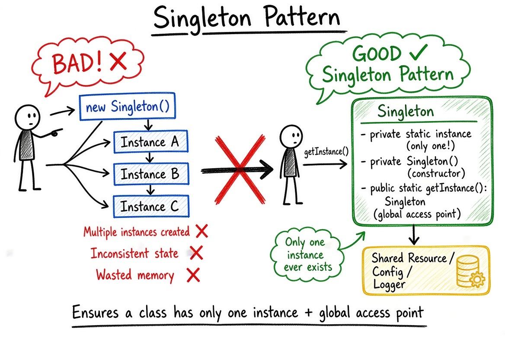

# 📚 Singleton Pattern



## 💡 Use Case

The Singleton pattern ensures a class has **only one instance** and provides a **global access point** to it.

When to use the Singleton pattern:

- You need exactly one shared resource across the whole app (logger, config, cache, DB connection pool)
- Creating the object is expensive and should happen only once
- All parts of the app must see the same state

In this example, we build an application **Logger**. Every service (users, payments, ...) writes to it, and the log level is configured once at bootstrap.

## ❌ Bad Practice

Every service creates its own logger with `new`:

```ts
export class BadLogger {
  private level: LogLevel = "info";
  private readonly entries: LogEntry[] = [];

  // public constructor: anybody can create as many loggers as they want
  constructor() {}
  // ...
}

export class BadUserService {
  readonly logger = new BadLogger(); // Instance A
}

export class BadPaymentService {
  readonly logger = new BadLogger(); // Instance B
}

const appLogger = new BadLogger(); // Instance C
appLogger.setLevel("debug");

new BadPaymentService().charge(49); // debug log is silently dropped!
```

### 🔥 Why This Is Bad

1. **Multiple instances created**: every `new` runs the (possibly expensive) setup again
2. **Inconsistent state**: setting the level on one logger does not affect the others
3. **Wasted memory**: each instance keeps its own buffer, and logs are scattered across them

## ✅ Good Practice

Make the constructor `private`, keep the only instance in a `private static` field, and expose it through `public static getInstance()`:

```ts
export class Logger {
  // private static instance (only one!)
  private static instance: Logger | null = null;

  private level: LogLevel = "info";
  private readonly entries: LogEntry[] = [];

  // private constructor: `new Logger()` is not allowed outside this class
  private constructor() {}

  // public static getInstance(): the global access point
  static getInstance(): Logger {
    if (!Logger.instance) {
      Logger.instance = new Logger();
    }
    return Logger.instance;
  }

  setLevel(level: LogLevel) {
    this.level = level;
  }

  log(level: LogLevel, context: string, message: string) {
    // ...
  }
}
```

### 🧼 Clean Usage (Client Code)

```ts
export class UserService {
  private readonly logger = Logger.getInstance();
}

export class PaymentService {
  private readonly logger = Logger.getInstance();
}

// Configure once, at application bootstrap
Logger.getInstance().setLevel("debug");

new UserService().register("john@example.com");
new PaymentService().charge(49); // debug log is kept ✅

Logger.getInstance() === Logger.getInstance(); // true
```

`new Logger()` is now a compile-time error, so there is no way to accidentally create a second instance.

## ⚠️ Things to Keep in Mind

- A singleton is **global state**. Overusing it hides dependencies and couples code together.
- It makes testing harder, since state leaks between tests. That's why this example has a `resetInstance()` helper for tests.
- In many frameworks (e.g. NestJS, Angular), the [Dependency Injection](../dependency-injection/) container already gives you singleton-scoped services. Prefer that over a hand-written singleton when available.
